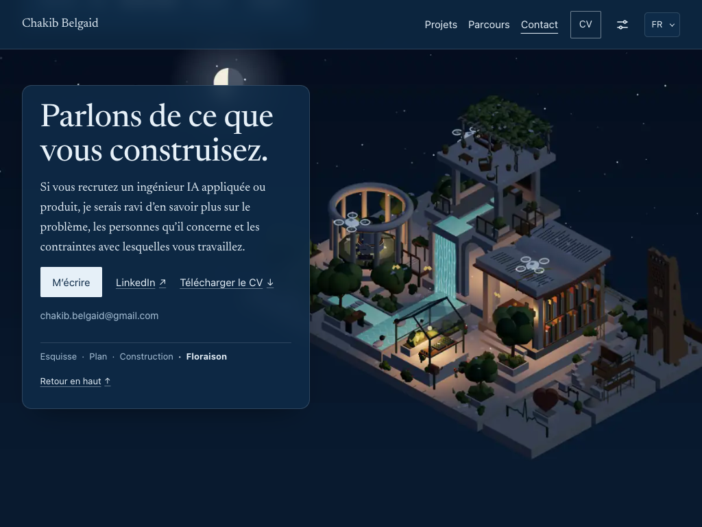
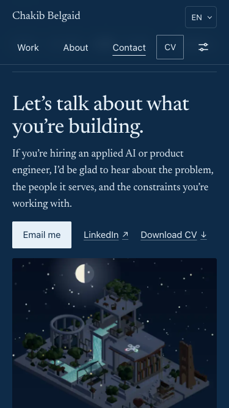
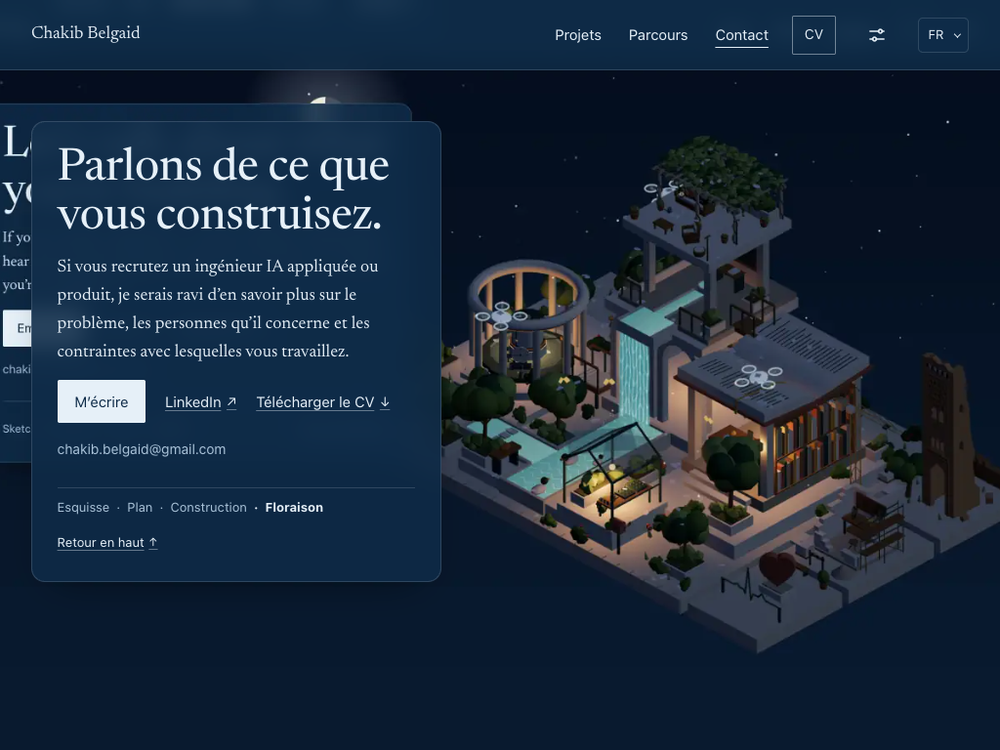
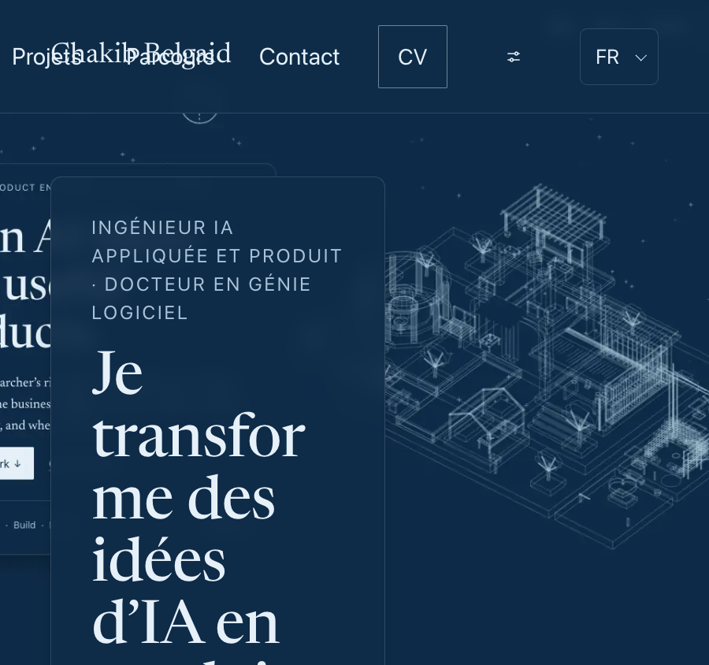
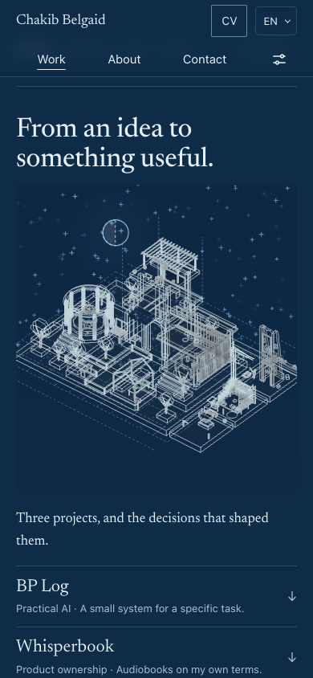
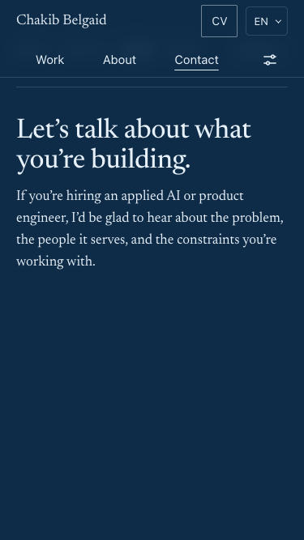

# UX validation — 2 November 2026

**Follow-up verdict: all five findings fixed and verified in the working tree.** The accepted navy scene and text-card direction is retained. The original audit and its before screenshots remain below for traceability; the implementation results in this section supersede its outstanding recommendations.

Original audit baseline: `80ea33b0e0f99f39ff72490d86e19f381527b2d9`. Follow-up changes are currently uncommitted. This covers the local production build, not a newly deployed public site.

## Follow-up implementation and verification

The user requested GPT-6.1 Sol to implement every caveat. That agent made the source changes and added focused browser regressions. The primary agent reviewed the changes, independently checked the layouts, generated all replacement assets, and executed the browser assertions.

| Finding | Resolution | Verification |
| --- | --- | --- |
| UX-01 | `captureScene()` isolates the scene subtree without changing layout; all six wide and six portrait posters regenerated from the live scene. Portrait capture brings offscreen hosts into view before awaiting a settled draw. | Wide/portrait pixel comparisons pass; standalone poster inspection and a French stills Contact screenshot show no baked-in page UI. All 12 files remain below 100 KB each. |
| UX-02 | Header rows wrap according to their contents. Actual sticky height becomes the anchor clearance; controller and scene geometry observe header resizes. Very tall headers scroll in document flow; no-JS and print headers remain in flow. | Independent 30-scenario normal/200% layout matrix passes. Fifteen additional enlarged-text regression scenarios verify bounds, collisions, clearance, actual navigation, and focus. |
| UX-03 | Work's project index now precedes its scene in the semantic document. | All four choices fit on the 390×844 first view in EN/FR/AR; the focused tests also pass at 375×667. |
| UX-04 | Contact actions now precede its scene. | Email action is fully visible at both 375×667 and 390×844 in all three languages. |
| UX-05 | Link now reads “Read Android case study,” with corresponding French and Arabic strings. | Translation coverage passes; the French case link and return journey work. |

Final checks:

- Production build and TypeScript: **passed**. The existing large scene-chunk warning remains.
- Model and translation tests: **19/19 passed**.
- New browser regressions: **23/23 passed**, executed through their exported assertions against request-intercepted production files in Chrome 156. This is the same assertion logic wired into `tests/ux-regressions.test.mjs`; the CLI browser runner itself was not run through a preview server.
- Additional final browser scenarios: **5/5 passed** — French stills Contact, no-JS direct Contact, keyboard/disclosure/print header behavior, history plus French Android case return, and scene-import failure.
- Independent layout matrix: **30/30 passed** — EN/FR/AR × 320/390/768/900/1440 CSS px × normal/200% text, including clickable Contact navigation and heading clearance. [Measurements](layout-results.json).
- Final browser results: [28 checks](browser-results.json), comprising the 23 new regressions and five additional scenarios.
- `git diff --check` and capture/regression-script syntax checks: **passed**.

The browser tool exposes JavaScript results across a VM boundary; the temporary request-interception harness normalized serialized `page.evaluate()` results before strict assertions. This avoids cross-realm array-prototype false failures without changing any asserted values or product code.

Asset capture: native Apple M5 Metal renderer, Chrome 156, 1440×900 desktop/full quality and 390×844 emulated touch/light quality, DPR 2, 22:00/clear/summer, each actual chapter pose settled. Wide output resized to 1440×900; portrait output 700×760. WebP quality 70. Wide files: 19,608–49,648 bytes; portrait files: 12,342–36,338 bytes. Live captures reported no page errors. Temporary captures and detailed capture-state records remain under `.qa/ux-2026-11-02/`.

These targeted fixes do not establish the complete P7/P8 release gate, field performance, native browser zoom, physical-phone behavior, or screen-reader conformance. No deployment or commit was made.

## Method and requirements

Applied the requested `donchitos-ccgs-codex:ux-design` skill's dimensions: visitor need and context, information hierarchy, entry/exit paths, interaction feedback, states and failures, motion, accessibility, localization, and testable acceptance criteria. The task is validation of an existing website, so the existing narrative specification is the input; this report does not author a new game UX specification.

Requirements came from:

- `docs/handoff/sketchbook-to-house/ACCEPTANCE.md`, especially V5/V7/V11, F1/F2/F5/F10/F13/F21, and A1–A9.
- `docs/handoff/sketchbook-to-house/references/narrative-design.md`.
- The G2 decision recorded in `PROGRESS.md`: retain the navy night theme and left text card over the full-viewport scene.
- The implemented chapter, rendering, navigation, preferences, and capture code.

Assumed primary visitor: a recruiter or engineering lead who wants to understand Chakib's role, inspect relevant work and evidence, then obtain a CV or make contact. These are review assumptions inferred from the site's copy and links, not findings from participant research. Inputs reviewed: mouse, keyboard, and emulated touch. The game-specific configuration questions do not apply to this portfolio.

Built the production output with `npm run build`. Exercised that output in headless Chrome **156.0.8078.76**, using the Apple M5 Metal renderer. Production files were fulfilled into a test origin by Playwright because the shell environment could not bind a local preview port. External requests were blocked. This preserves browser layout, JavaScript, navigation, and WebGL behavior; it does **not** measure deployment or network performance.

## Original findings

| ID | Priority | Finding | Visitor impact | Recommended action |
| --- | --- | --- | --- | --- |
| UX-01 | P1 — sign-off blocker | Desktop fallback images contain rendered page UI | Duplicate English copy, cards, and apparent controls appear behind the real localized page | Regenerate scene-only posters and correct the capture process |
| UX-02 | P1 — sign-off blocker | Header controls collide with enlarged text | Navigation becomes obscured; some narrow layouts overflow horizontally | Allow the header to reflow according to content and retain accurate landing offsets |
| UX-03 | P2 — usability | Mobile Work places the large scene before the project index | Visitors must scroll past decoration to compare the work they requested | Put project choices before the Work scene on narrow screens |
| UX-04 | P2 — usability | Mobile contact actions follow the large scene | The email action is below the initial view on a short phone | Put contact actions beside the introduction, before the scene |
| UX-05 | P3 — copy | “Existing Android case” describes implementation history | Visitors have to infer whether this is the substantive case study | Use a destination label such as “Read Android case study” |

P1 means a defect to resolve before this review can approve the affected experience. P2 and P3 indicate recommendations, not a claim that an external accessibility standard has been formally assessed.

### UX-01 — Page UI baked into scene posters

**Reproduce:** open `/?lang=fr#contact` with reduced motion enabled at 1024×768. The real French contact card appears in front of a second, offset English contact card embedded in the background. The standalone `public/assets/stills/wide/sketch.webp` also visibly contains the header, headline, body text, buttons, and chapter footer.

This affects the presentation used while the scene loads and when stills, reduced motion, or rendering failure keep a poster visible. The page remains operable, but the fallback is visually misleading. Different languages and viewport sizes make the problem especially obvious.

**Location:** `scripts/capture-stills.mjs:90` captures the stage's screen rectangle while overlapping page elements are visible. The resulting raster includes those elements. Fix the capture isolation, then regenerate and inspect the wide set. Verify portrait captures too rather than assuming the same defect is present there.

**Acceptance:** posters contain only the intended scene; no name, navigation, card, body copy, or button is rasterized. At 900, 1024, and 1440 CSS px, EN/FR/AR stills and reduced-motion views display one visible text layer and no fake controls. Check loading and scene-failure states as well.

### UX-02 — Enlarged-text header collisions

**Reproduce:** at 900×844 with French selected, change the root font size from 16 to 32 px to simulate a 200% text-size preference. “Projets” and “Parcours” overlap the name; the first navigation link begins at approximately x = −9 px. At 320 px in English, document width grows to approximately 385 px; at 390 px in French it grows to approximately 441 px. The name/CV and navigation/settings controls overlap. Arabic also exhibits control collisions at 320 px, despite reporting no excess document width.

**Location:** fixed row allocations and pixel-based breakpoints in `src/narrative/style.css:71–104`, including the non-wrapping navigation row and shrinking central grid track. Normal-size EN/FR/AR at 320 px did not exhibit these collisions.

**Recommendation:** allow content to wrap into additional rows when necessary; let header height follow its content and ensure fragment/focus clearance follows the actual height. Do not solve the issue by clipping or hiding essential links.

**Acceptance:** repeat the same text-size preference at 320, 390, 768, 900, and 1440 CSS px for EN/FR/AR. Every header control is readable, has a distinct clickable area, and remains reachable without forced horizontal page scrolling. Recheck keyboard focus and direct section landings after the header changes. This simulation identifies a real layout defect; it is not a complete browser zoom or WCAG conformance test.

### UX-03 — Work choices arrive too late on mobile

At 390×844, activating Work puts the heading first, then an approximately **380 px** scene, then the supporting sentence, and only then the project choices. BP Log and part of Whisperbook are visible at the bottom; the energy tools and professional experience need more scrolling.

**Location:** `src/render.ts:110` puts Work's motivation in the body; `workIndex()` is also appended to that body at line 128, after the scene inserted at line 143.

The scene remains a valuable part of the narrative. For this overview, the visitor's immediate task is choosing a project. Place those choices before the scene, while retaining the transformation below them.

**Acceptance:** after Work navigation at 390×844, all four project destinations are discoverable in the initial viewport, with ordinary links and clear names. The scene remains present in the document and scrolling continues normally.

### UX-04 — Contact actions below the scene

At 390×844, the email button begins around y = 728 px. At **375×667**, direct Contact navigation places the email button at approximately **y = 676–720 px**, entirely below the viewport. Visitors who explicitly requested contact must scroll past the finished-house illustration to act.

**Location:** `src/render.ts:124–144` puts only Intro's actions in the lead; Contact's actions are in the body after the scene.

**Acceptance:** at 375×667 and 390×844 in each supported language, Contact navigation immediately exposes the email action without an extra scroll. Keep the house and the remaining contact information available below it.

### UX-05 — Case-study label

`src/narrative/content.ts:99` labels a public-facing link “Existing Android case.” The route identity is correct, and its return journey worked. The wording can simply say what the visitor will get: an Android case study. Update the corresponding translations if changing it.

## What worked in the reviewed scenarios

| Area | Observed result |
| --- | --- |
| Opening hierarchy | Role, promise, primary action, and CV visible before scrolling at 1440×900 and 390×844 |
| Visual direction | Navy palette, readable text card, and recognizable progression form a coherent identity |
| Primary navigation | Work, project, and Contact jumps established the expected destination and focused its heading clear of the sticky header |
| Keyboard | First 13 Tab stops had visible focus and a sensible reading sequence; the skip link was available |
| Controls | Motion/sound disclosure dismissed with Escape and restored focus to its trigger |
| Case round trip | Work → Whisperbook → Android case → explicit Return restored `#whisperbook` and its reading position |
| Local cases | All six retained EN/FR cases loaded without observed missing local responses, page errors, or broken image elements; each exposed two Return links |
| Localization | EN/FR/AR worked at normal text size at 320 px without horizontal overflow; Arabic used RTL flow. Switching Whisperbook to French retained the chapter and selected the French case and CV URLs |
| Responsive layout | Normal-size French About landings at 320, 390, 768, 900, and 1024 px had no measured horizontal document overflow or out-of-bounds header controls |
| Semantic content | One main, one h1, and eight chapter sections; the live scene stage was hidden from assistive navigation |
| Reduced motion | A fresh reduced-motion visit used stills with no live renderer |
| Sound | Sound remained off during the reviewed navigation; it did not start from Work/Contact actions |
| No JavaScript | All eight chapters and the mailto destination remained in the phone document, without horizontal overflow |
| Scene import failure | Content and source links remained usable, a matching poster remained, and the controls explained the fallback; UX-01 still affects its visual quality |

These results apply to the named scenarios, not every permutation of browser, route, and preference.

## Original audit verification and limits

- `npm run build`: **passed**. Vite reported its existing large scene-chunk warning.
- `node --test tests/narrative-model.test.mjs tests/translations.test.mjs`: **19/19 passed**.
- An initial combined run also included `tests/browser-fixture.test.mjs`: that test could not launch its bundled Chromium under the shell sandbox and failed before its fixture assertion. Browser review continued separately in the working Chrome tool runtime. This is not recorded as a passing test.
- The complete browser regression suite and the P7/P8 release gate were **not** completed by this audit. Existing progress and design gates remain unchanged.
- No physical phone, Safari/Firefox, VoiceOver, exhaustive contrast analysis, print acceptance, native browser zoom, or participant usability study was performed.
- No new deployment, network timing, Core Web Vitals, frame-budget, CV factual verification, or external-link availability claim is made. Production files were served through request interception; that setup cannot establish network performance.
- Product screenshots and richer evidence pages remain useful future work. The current text-first treatment is an explicit release-1 decision, so their absence is not counted here as a new blocker or as permission to invent evidence.

## Follow-up disposition

**UX-01 through UX-05 are resolved by the implementation and targeted checks above.** Broader release acceptance and the existing design gates remain separate; this report does not replace the user's visual acceptance or authorize publication.
